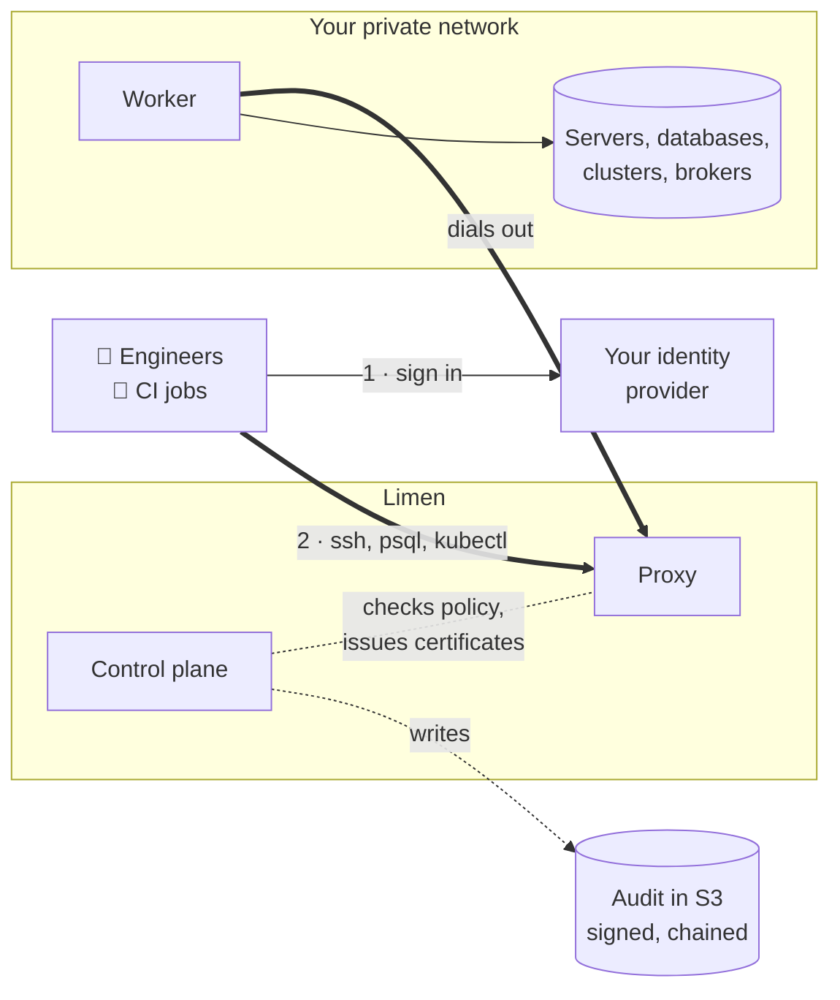

<p align="center">
  <picture>
    <source media="(prefers-color-scheme: dark)" srcset="assets/logo-dark.svg">
    
  </picture>
</p>

<h3 align="center">Access that expires. An audit trail you can prove.</h3>

<p align="center">
  Identity-aware access to SSH, databases, Kubernetes, message brokers and internal apps.<br>
  Open source, written in Rust, and run on your own infrastructure.
</p>

<p align="center">
  
  
  
  <a href="https://github.com/limen-dev/.github/blob/main/SECURITY.md"></a>
</p>

<br>

<table>
  <tr>
    <td width="33%" valign="top">
      <br>
      <b>Nothing long-lived</b><br>
      <sub>Each session gets a certificate that expires in an hour, or sooner if you choose. CI jobs sign in with their own OIDC token, so no person or pipeline keeps a key or a password.</sub>
    </td>
    <td width="33%" valign="top">
      <br>
      <b>An audit you can verify</b><br>
      <sub>Every session is recorded or audited into signed, hash-chained batches. One command proves nothing was edited, reordered or removed. If audit can't be written, new sessions are refused.</sub>
    </td>
    <td width="33%" valign="top">
      <br>
      <b>No inbound ports</b><br>
      <sub>Workers run next to your targets and dial out. Your servers and databases stay private, and only the worker ever holds their credentials.</sub>
    </td>
  </tr>
</table>

## What it looks like

```console
$ limen login                     # a browser opens on your identity provider
$ limen ls
NAME             KIND        ACCESS AS                LABELS
orders-staging   ● postgres  limen_read, limen_write  env=staging team=payments
web-staging-1    ● ssh       ec2-user, ubuntu         env=staging

$ limen ssh web-staging-1         # a recorded session, with a one-hour certificate
$ limen db connect orders-staging # psql through Limen, no password to copy
$ limen explain orders-prod       # which rule stops me?
$ limen request orders-prod --for 30m --reason "INC-123"
```

## How it works



<p align="center"><sub>Nothing inside your network opens a port: the worker connects out to the proxy, and only the worker holds target credentials.</sub></p>

## What it reaches

<p align="center">
  &nbsp;&nbsp;&nbsp;
  &nbsp;&nbsp;&nbsp;
  &nbsp;&nbsp;&nbsp;
  &nbsp;&nbsp;&nbsp;
  &nbsp;&nbsp;&nbsp;
  &nbsp;&nbsp;&nbsp;
  &nbsp;&nbsp;&nbsp;
  <picture><source media="(prefers-color-scheme: dark)" srcset="https://cdn.simpleicons.org/elasticsearch/white"></picture>&nbsp;&nbsp;&nbsp;
  &nbsp;&nbsp;&nbsp;
  <picture><source media="(prefers-color-scheme: dark)" srcset="https://cdn.simpleicons.org/apachekafka/white"></picture>&nbsp;&nbsp;&nbsp;
  
</p>

<p align="center"><sub>SSH · PostgreSQL · MySQL · Redis and Valkey · Kubernetes · MongoDB · OpenSearch · Elasticsearch · RabbitMQ · Kafka · internal web apps · anything else over TCP<br>Works with your own servers and with the AWS managed services (RDS, Aurora, ElastiCache, EKS, MSK, Amazon MQ)</sub></p>

## Repositories

| Repository | What it is |
|---|---|
| **[limen](https://github.com/limen-dev/limen)** | The control plane, proxy, worker and `limen` CLI, the web console, and the docs |
| **[terraform-provider-limen](https://github.com/limen-dev/terraform-provider-limen)** | Manage resources, roles and bots from Terraform or OpenTofu, through the management API |
| **[homebrew-tap](https://github.com/limen-dev/homebrew-tap)** | `brew install limen-dev/tap/limen` |

## Where it stands

> [!IMPORTANT]
> **Limen is pre-release.** There is no tagged release yet. Everything is tested end to end, but against local stand-ins: Dex in place of a real identity provider, databases and brokers in containers, a local S3. Nothing has been verified against real AWS, Okta or Datadog. Evaluate it; don't put it in front of production systems yet.

<p align="center"><sub>
  <i>Limen</i> is Latin for threshold: the line you cross to get in.<br>
  Found a security problem? Please <a href="https://github.com/limen-dev/.github/blob/main/SECURITY.md">report it privately</a>.
</sub></p>
